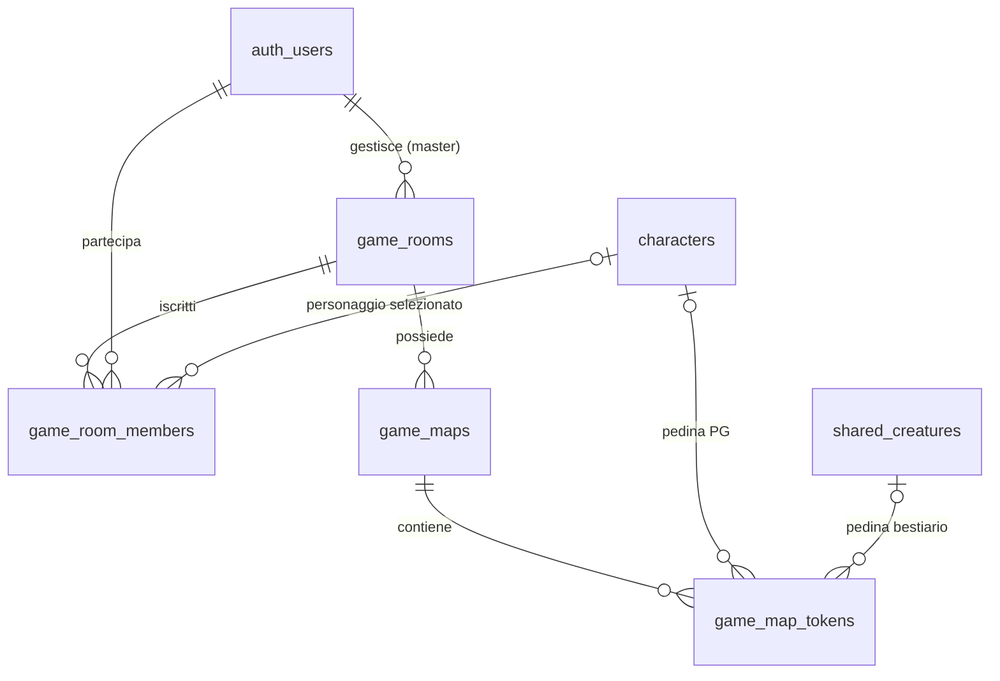

# D&D — stanze e griglia di combattimento (Supabase, v1)

Questa migrazione è **additiva**: introduce 4 tabelle e non modifica `characters`, `character_companions`, `shared_spells` né i cataloghi. Presuppone l'esistenza di `public.shared_creatures` dal precedente schema, oltre a `public.characters` con `id` UUID chiave primaria e `user_id` UUID.

## Installazione

1. Fai un backup ed esegui `dnd_stanze_battaglia.sql` in un **progetto Supabase di test** con SQL Editor (oppure come migrazione CLI).
2. Esegui `dnd_stanze_verifica.sql` e controlla che le quattro tabelle abbiano RLS `true`, le quattro tabelle compaiano in `supabase_realtime`, il bucket `game-maps` sia **privato** e le policy siano presenti.
3. Nelle impostazioni Realtime, usa **canali privati**. Per una protezione completa, disattiva `Allow public access` (controlla prima l'impatto su eventuali canali pubblici dell'app).
4. Usa SDK Supabase autenticato: non esporre `secret key` o `service_role` nel browser.

> **Limite di verifica:** la migrazione è stata analizzata staticamente, ma non è stata eseguita contro il tuo progetto Supabase. Esegui prima in staging; per ripetere una migrazione esistente serve una migrazione successiva, non rieseguire il file.

## Entità e relazioni



- `game_rooms`: stanza, master (`master_user_id`), titolo, codice di invito (16 caratteri esadecimali), stato (`lobby/active/closed`), limite giocatori. Il master è membro **implicito**: non necessita una riga `game_room_members`.
- `game_room_members`: iscrizioni persistenti degli altri utenti, personaggio selezionato (opzionale), nome visualizzato, stato (`joined/left/kicked`). **Non** indica connessione online.
- `game_maps`: una o più mappe per stanza; **solo una attiva**. Dimensioni della griglia, cella in pixel, scostamenti, opacità, visibilità, misura piedi/cella e path immagine.
- `game_map_tokens`: posizione persistente e dimensione (es. 2×2 celle), token di PG collegato a `characters`, nemico collegato a `shared_creatures` o pedina libera. Per rimuovere una pedina si imposta `is_removed=true` (il frontend filtra quelle rimosse).

## Permessi

| Operazione | Master | Giocatore iscritto | Utente esterno |
|---|---|---|---|
| Leggere stanza e membri | sì | sì | no |
| Caricare/modificare mappa | sì | no | no |
| Vedere mappa e pedine visibili | sì | sì | no |
| Inserire/editare pedine (contenuti) | sì | no | no |
| Muovere una pedina PG | sì | solo quella del proprio personaggio | no |
| Entrare con codice invito | già ammesso | tramite RPC | sì, dopo autenticazione e controllo codice |
| Cambiare personaggio iscritto | — | solo il proprio | no |
| Espellere giocatore | sì | no | no |

**Nota:** chi è espulso non può rientrare neppure conservando il codice; il master può inoltre rigenerare il codice. Una nuova connessione Realtime è autorizzata in base alla membership; **l'espulsione non garantisce la chiusura istantanea di una connessione WebSocket già aperta**: prevedi riconnessione/refresh o revoca lato server se necessario.

## Flusso: creare una stanza

Dal frontend autenticato usa la RPC, così il master viene ricavato da `auth.uid()` e non può essere falsificato dal browser:

```ts
const { data: room, error } = await supabase.rpc('create_game_room', {
  p_title: 'Sessione del venerdì',
  p_description: null,
  p_max_players: 6
});
```

Condividi il codice (o costruisci un link `/join?code=...`). Solo chi è dentro la stanza può leggerla tramite `SELECT` e conoscerne il codice; un utente esterno può usarlo tramite la RPC di ingresso.

## Flusso: entrare e scegliere un personaggio

```ts
const { data: roomId, error } = await supabase.rpc('join_game_room', {
  p_invite_code: inviteCode,
  p_character_id: selectedCharacterId, // oppure null
  p_display_name: 'Thorin'
});

// Per cambiare PG successivamente:
await supabase.rpc('set_game_room_character', {
  p_room_id: roomId, p_character_id: selectedCharacterId
});

// Per abbandonare volontariamente:
await supabase.rpc('leave_game_room', { p_room_id: roomId });
```

Il PG deve essere di proprietà dell'utente (`characters.user_id`). Per un giocatore è prevista **una scelta di PG attiva per stanza**; in futuro puoi estendere a più PG per utente con una tabella separata.

## Flusso: creare mappa e caricare immagine

Ordine fondamentale: **prima crea la riga della mappa**, poi carica il file, infine aggiorna `image_storage_path`, perché le policy Storage verificano l'esistenza della mappa.

```ts
const { data: map } = await supabase.from('game_maps')
  .insert({ room_id: roomId, title: 'Caverna dei goblin',
    grid_columns: 30, grid_rows: 20,
    grid_cell_size_px: 64, grid_offset_x_px: 0,
    grid_offset_y_px: 0 })
  .select('id').single();

const path = `${roomId}/${map.id}/background.webp`;
const { error: uploadError } = await supabase.storage
  .from('game-maps').upload(path, imageFile, { contentType: 'image/webp' });
if (!uploadError) {
  await supabase.from('game_maps').update({
    image_storage_path: path,
    image_width_px: 1920, image_height_px: 1280 // dimensioni reali del file
  }).eq('id', map.id);
}
await supabase.rpc('activate_game_map', { p_room_id: roomId, p_map_id: map.id });
```

`image_width_px` e `image_height_px` devono coincidere con quelle originali del file: rilevale dal file in fase di caricamento, non usare numeri fissi. Per rendere il background privato, chiedi un **signed URL** autenticato allo Storage. Il rendering (HTML Canvas/SVG/DOM) deve usare lo stesso sistema di coordinate per immagine, griglia e pedine.

Posizione grafica in pixel, **prima dello zoom**:

```ts
const left = gridOffsetXpx + token.grid_x * gridCellSizePx;
const top  = gridOffsetYpx + token.grid_y * gridCellSizePx;
const width = token.size_columns * gridCellSizePx;
const height = token.size_rows * gridCellSizePx;
```

Per le mappe con immagine non perfettamente allineata puoi regolare offset e misura della cella; lo zoom agisce sul contenitore immagine+griglia+pedine.

## Flusso: pedine e spostamenti

Il master può inserire una pedina PG già selezionata da un giocatore:

```ts
await supabase.from('game_map_tokens').insert({
  room_id: roomId, map_id: mapId,
  token_type: 'character', character_id: playerCharacterId,
  owner_user_id: playerUserId, name: 'Thorin',
  grid_x: 4, grid_y: 7, size_columns: 1, size_rows: 1
});
```

Il giocatore può spostare **solo** il token associato al proprio PG, e **solo** cambiando `grid_x` e `grid_y`. Controlli RLS e trigger impediscono di modificare nome, proprietà, visibilità e campi di un'altra pedina. Il movimento deve rientrare nella griglia. Esempio:

```ts
await supabase.from('game_map_tokens')
  .update({ grid_x: 5, grid_y: 7 })
  .eq('id', tokenId);
```

Per una creatura dal bestiario, il master imposta `token_type='creature'` e `shared_creature_id`; per un segnalino libero usa `token_type='custom'`. Una pedina 2×2 occupa quattro celle. Questo modello **non implementa ancora** movimenti diagonali, ostacoli, collisioni, portata, fog of war o iniziativa automatica.

## Realtime: dati persistenti + presenza online

Con **Postgres Changes** ascolta `game_map_tokens` filtrando `room_id`/`map_id` e `game_maps` filtrando `room_id`; dopo una modifica aggiorna la UI. I movimenti sono persistenti: chi entra in un secondo momento legge il posizionamento attuale con `SELECT`.

Usa **Presence** su un canale privato `game-room:${roomId}` per mostrare utenti online, con `userId` e nome in `track(...)`; non creare una tabella di "online": la connessione è temporanea.

```ts
const channel = supabase.channel(`game-room:${roomId}`, {
  config: { private: true, presence: { key: user.id } }
});
channel
  .on('presence', { event: 'sync' }, () => {
    console.log(channel.presenceState());
  })
  .subscribe(async status => {
    if (status === 'SUBSCRIBED') {
      await channel.track({ userId: user.id, displayName: 'Thorin' });
    }
  });
```

Per la sincronizzazione **durante il drag**, preferisci Broadcast e invia la posizione definitiva al database al `pointerup`. Non chiamare Presence ogni volta che il mouse si muove. Controlla la configurazione **private channels** di Supabase e le relative policy `realtime.messages` incluse nella migrazione.

### Note sulle pedine nascoste

`is_hidden` nasconde il token dai SELECT degli altri giocatori; il master continua a vederlo. Quando un token passa da visibile a nascosto, manda un evento `refresh-map` sul canale privato: gli altri client devono rieseguire il SELECT per eliminare anche l'eventuale copia già in memoria. La stessa tecnica è utile dopo l'espulsione di un utente.

## Evoluzioni successive (non comprese nell'MVP)

- Turni e iniziativa: `game_encounters`, `game_initiative`.
- Fog of war, ostacoli, pareti, line of sight e griglie esagonali.
- Token multipli per giocatore, famigli collegati a `character_companions`.
- Log mosse e rollback del master.
- Permessi più granulari: soltanto GM muove i token, movimento approvato, spettatori.

### Limiti e attenzione

- La tabella `game_room_members` gestisce l'iscrizione; **non** la presenza online.
- I riferimenti ai cataloghi 2014/2024 restano nelle entità originali; la griglia non duplica le regole.
- I file Storage **non vengono eliminati automaticamente** quando cancelli una mappa: elimina gli oggetti con l'API Storage prima di cancellare la riga. Lo stesso vale per le vecchie immagini sostituite.
- La migrazione non implementa rate limiting del codice invito; prevedi limiti applicativi o un gateway per evitare tentativi ripetuti.
- I `DELETE` replicati da PostgreSQL richiedono particolare attenzione alle limitazioni RLS; qui l'interfaccia usa **rimozione logica** delle pedine tramite `is_removed` e canali privati.
- I controlli di RLS sono essenziali ma vanno **testati con account reali distinti** (master, giocatore, esterno, espulso).
